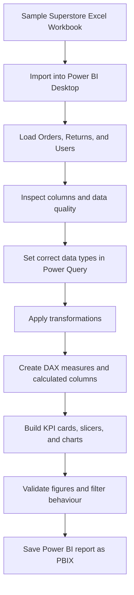
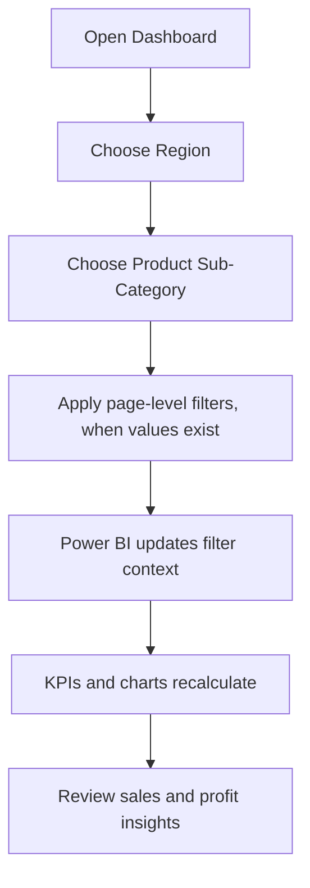

# Superstore Sales Analysis Dashboard

An interactive sales analytics project built with **Microsoft Power BI** using the Sample Superstore Excel dataset. The report is designed to explore sales, profitability, order quantity, discounts, regional performance, and product sub-categories through KPI cards, slicers, and charts.

> **Project files:** `Sample - Superstore Sales (Excel).xlsx` · `Superstore_Sales_Dashboard.pbix`

---

## Project Overview

The purpose of this project is to transform row-level Superstore transaction data into an interactive business intelligence report. It helps users review overall performance and investigate how sales and profit vary by region, product group, customer segment, and shipping method.

### Objectives

- Analyse total sales, total profit, order quantity, and discount.
- Compare performance across the four business regions.
- Explore product categories and sub-categories.
- Review sales and profit patterns using report visuals.
- Use slicers and filters to interact with the report.
- Practise data import, data preparation, DAX calculations, and dashboard design in Power BI.

## Tools & Technologies

| Tool | Purpose |
|---|---|
| Microsoft Power BI Desktop | Data modelling, DAX, report visuals, and dashboard design |
| Microsoft Excel (`.xlsx`) | Source dataset |
| Power Query | Data inspection, type checking, and preparation |
| DAX | Measures and calculated columns |
| Mermaid | Project workflow and interaction flowcharts in this README |

## Project Files

```text
Superstore-Sales-Analysis/
├── README.md
├── Sample - Superstore Sales (Excel).xlsx
└── Superstore_Sales_Dashboard.pbix
```

## PBIX File Validation Note

The supplied PBIX package contains a single report-page definition. During package inspection, no separate visual-definition files were exposed in its report structure. Open the PBIX in Power BI Desktop and confirm that the visuals are present before publishing or submitting the project; if the page opens blank, restore or recreate the visuals and save the PBIX again.

## Dataset Information

The uploaded Excel workbook contains three worksheets:

| Worksheet | Contents | Rows (excluding header) |
|---|---|---:|
| `Orders` | Transaction-level sales, profit, customer, product, region, and shipping details | 8,399 |
| `Returns` | Order IDs and return status | 572 |
| `Users` | Region and manager information | 19 |

The `Orders` worksheet contains 23 columns, including:

- **Order details:** `Row ID`, `Order ID`, `Order Date`, `Order Priority`, `Ship Date`, `Ship Mode`
- **Sales and profit:** `Sales`, `Profit`, `Discount`, `Order Quantity`, `Unit Price`, `Shipping Cost`, `Product Base Margin`
- **Customer and location:** `Customer Name`, `Customer Segment`, `City`, `Zip Code`, `State`, `Region`
- **Product details:** `Product Category`, `Product Sub-Category`, `Product Name`, `Product Container`

The source data contains **795 distinct customer names** and **5,496 distinct order IDs** in the Orders worksheet.

## Dashboard Contents

The current report design includes the following elements:

- **KPI cards:** Sum of Sales, Sum of Profit, Sum of Order Quantity, and Sum of Discount.
- **Region slicer:** Filter the report by Central, East, South, or West.
- **Product Sub-Category slicer:** Focus on selected product sub-categories.
- **Sales vs Profit visual:** Compare sales/profit performance in the report.

### Recommended Enhancements

These are suggested next steps and should only be marked as complete after they have been added to the PBIX report:

1. Replace the summed discount KPI with **Average Discount** and format it as a percentage.
2. Use **Distinct Count of Order ID** for a Total Orders KPI.
3. Add a Sales by Category chart.
4. Add a monthly Sales Trend line chart using Order Date.
5. Add a Profit by Sub-Category bar chart.
6. Add a Sales by Ship Mode doughnut chart, where supported by the source data.
7. Apply consistent colours, spacing, titles, and visual formatting.

## Data Preparation Workflow

1. Open Power BI Desktop.
2. Select **Home → Get data → Excel workbook**.
3. Choose `Sample - Superstore Sales (Excel).xlsx`.
4. Select the `Orders`, `Returns`, and `Users` worksheets that are required for the report.
5. Choose **Transform Data** to inspect the columns and correct data types.
6. Apply transformations in Power Query and select **Close & Apply**.
7. Create required DAX measures and build report visuals.
8. Validate totals, slicers, and filters before saving the `.pbix` file.

### Recommended Data Types

| Column | Recommended type |
|---|---|
| `Order Date`, `Ship Date` | Date |
| `Sales`, `Profit`, `Discount`, `Unit Price`, `Shipping Cost`, `Product Base Margin` | Decimal number |
| `Row ID`, `Order Quantity` | Whole number |
| `Order ID` | Whole number or Text, used consistently across related tables |
| `Zip Code` | Text, to preserve leading zeros where present |
| Names, region, category, ship mode, status | Text |

## Data Flowchart



## Dashboard Interaction Flowchart



## Useful DAX Measures

Create these from **Modeling → New measure** in Power BI. The expressions assume the imported table is named `Orders` and the column names match the source workbook.

```dax
Total Sales =
SUM(Orders[Sales])
```

```dax
Total Profit =
SUM(Orders[Profit])
```

```dax
Total Orders =
DISTINCTCOUNT(Orders[Order ID])
```

```dax
Total Quantity =
SUM(Orders[Order Quantity])
```

```dax
Average Discount =
AVERAGE(Orders[Discount])
```

```dax
Distinct Customers =
DISTINCTCOUNT(Orders[Customer Name])
```

### Optional: Create a Derived Customer ID

The uploaded `Orders` worksheet does **not** contain a source `Customer ID` column; it contains `Customer Name`. When a customer identifier is needed for practice, the following calculated column can generate a repeatable label from the alphabetical rank of each distinct customer name:

```dax
Customer ID =
"CUST-" &
FORMAT(
    RANKX(
        ALL(Orders[Customer Name]),
        Orders[Customer Name],
        ,
        ASC,
        DENSE
    ),
    "0000"
)
```

This is a **derived reporting key**, not an official customer ID supplied by the dataset. Identical customer names receive the same generated label; different people with the same name cannot be distinguished using this source field alone.

## Important Dataset Note: Ship Mode Filter

The uploaded workbook's `Orders[Ship Mode]` column contains these values:

- `Regular Air`
- `Delivery Truck`
- `Express Air`

It does **not** contain `Standard Class` or `Second Class`. Therefore, a page-level filter selecting `Standard Class` and `Second Class` cannot be applied to this particular workbook as-is. To complete an assignment that specifically requires those two values, use the matching Superstore dataset or confirm the intended mapping with the assignment instructions. Do not rename shipping methods without verifying that the categories are equivalent.

## Suggested Report QA Checklist

- [ ] Confirm all three Excel worksheets load correctly.
- [ ] Verify date, numeric, and text data types.
- [ ] Check that sales and profit measures aggregate correctly.
- [ ] Use Distinct Count for the Total Orders KPI.
- [ ] Format Average Discount as a percentage.
- [ ] Test Region and Product Sub-Category slicers.
- [ ] Confirm page-level filters use values present in the dataset.
- [ ] Check visual titles, labels, alignment, and spacing.
- [ ] Save the final report as `Superstore_Sales_Dashboard.pbix`.

## How to Open the Project

1. Download the Excel dataset and the PBIX report.
2. Open `Superstore_Sales_Dashboard.pbix` in **Power BI Desktop**.
3. If Power BI asks for the source workbook location, browse to `Sample - Superstore Sales (Excel).xlsx` and confirm the path.
4. Refresh the data if required.
5. Review the report and save any updates.

## Conclusion

This project demonstrates an end-to-end introductory business intelligence workflow: importing Excel data, preparing fields, creating DAX calculations, and presenting sales and profitability information through an interactive Power BI report. It can be extended with additional visuals, validated filters, and deeper customer and product analysis.

---

**Author:** Armin Khareghat
**Project:** Superstore Sales Analysis Dashboard  
**Primary platform:** Microsoft Power BI Desktop  
**Dataset:** Sample Superstore Sales (Excel)
